<h1 align="center">Vexor</h1>

<p align="center">
  Terminal moderna para <b>Omarchy / Arch Linux (Hyprland)</b>, hecha con <b>Tauri 2 + Rust</b> y xterm.js.<br>
  Espacios de trabajo, splits, fondos de imagen o animados, IA, Git, Docker y más — sin salir de la terminal.
</p>

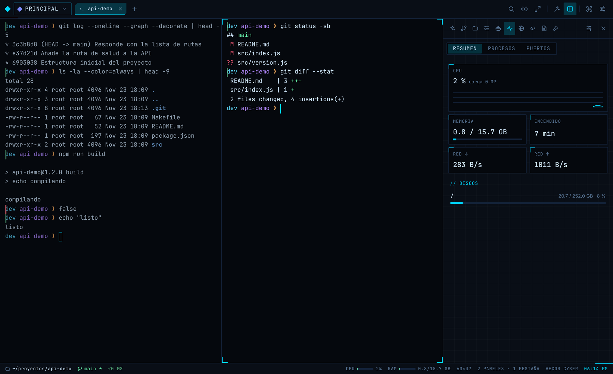

## Lo más destacado

- **Pestañas, splits y espacios de trabajo** (*Backend*, *Servidores*, *Ocio*…) con su propio color; los procesos de los otros espacios siguen vivos y todo se restaura al abrir.
- **Aspecto futurista (HUD)** sin resplandor por defecto, 11 temas, interfaz escalable del 75 % al 160 % y estilo *Limpio* si lo prefieres.
- **Fondo con imagen o animado** (lluvia digital, estrellas, red de partículas, gradiente), opacidad de ventana e **imágenes dentro de la terminal** (Sixel e iTerm2).
- **Herramientas integradas**: asistente de **IA** (Anthropic u cualquier API compatible con OpenAI: Ollama, LM Studio, OpenRouter…), **Git**, **Docker**, explorador de **archivos**, **tareas** del proyecto, **procesos y puertos**, **cliente HTTP**, snippets, notas e historial de comandos.
- **Paridad con Kitty / Alacritty** en lo cotidiano: modo vi, hints, integración de shell, atajos 100 % configurables, argumentos de línea de comandos.

## Instalar en Omarchy (un solo comando)

```bash
git clone https://github.com/TU_USUARIO/vexor.git && cd vexor
./scripts/instalar-omarchy.sh
```

El script instala las dependencias con `pacman`, compila Vexor, genera el **paquete de Arch** (`packaging/arch/vexor-<versión>-1-x86_64.pkg.tar.zst`) y lo instala con `pacman -U`. Después lo abres desde el menú de aplicaciones o con `vexor`. La primera compilación tarda varios minutos.

```bash
./scripts/instalar-omarchy.sh --compilar      # solo genera el paquete, sin instalarlo
./scripts/instalar-omarchy.sh --desinstalar   # lo quita (pacman -Rns vexor)
./scripts/instalar-omarchy.sh --ayuda
```

No lo ejecutes con `sudo`: pide la contraseña solo cuando la necesita. Si usas `rustup`, no instala otro Rust encima. Fuente recomendada: *JetBrainsMono Nerd Font* (viene con Omarchy).

## Uso en Hyprland

```ini
bind = SUPER, RETURN, exec, vexor
bind = SUPER SHIFT, B, exec, vexor -e btop
windowrulev2 = opacity 0.92 0.92, class:^(vexor)$   # transparencia (ajusta también “Opacidad” en Ajustes)
windowrulev2 = float, class:^(vexor-popup)$
```

Argumentos: `vexor --working-directory ~/proyecto -e nvim .` · `--no-restore` · `--title "Mi terminal"`.

## Capturas

> Las capturas usan un proyecto de demostración y un servidor de IA **simulado**; no muestran datos reales.

### Espacios de trabajo y pestañas laterales
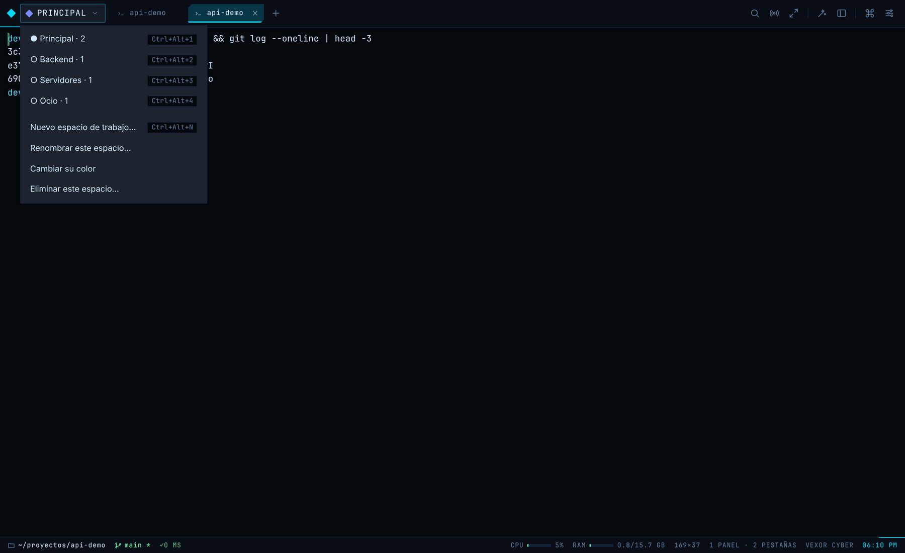
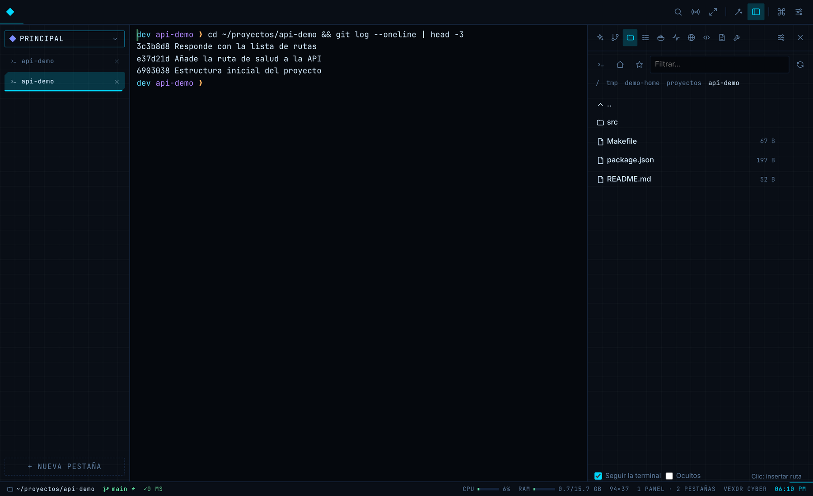

### Herramientas
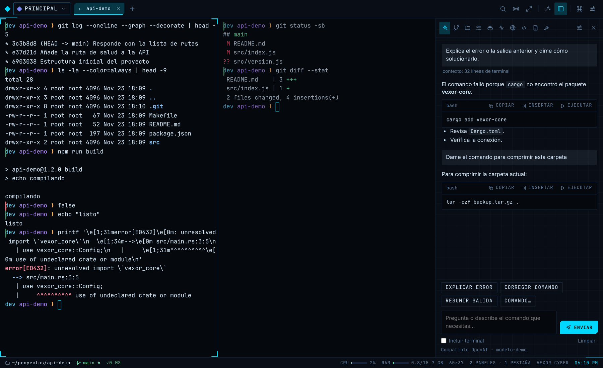
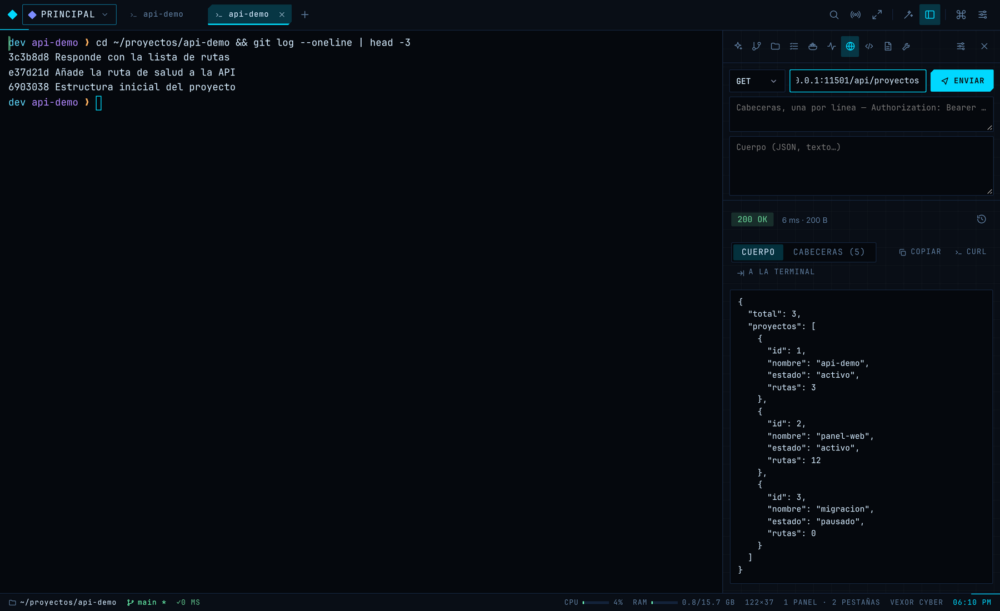
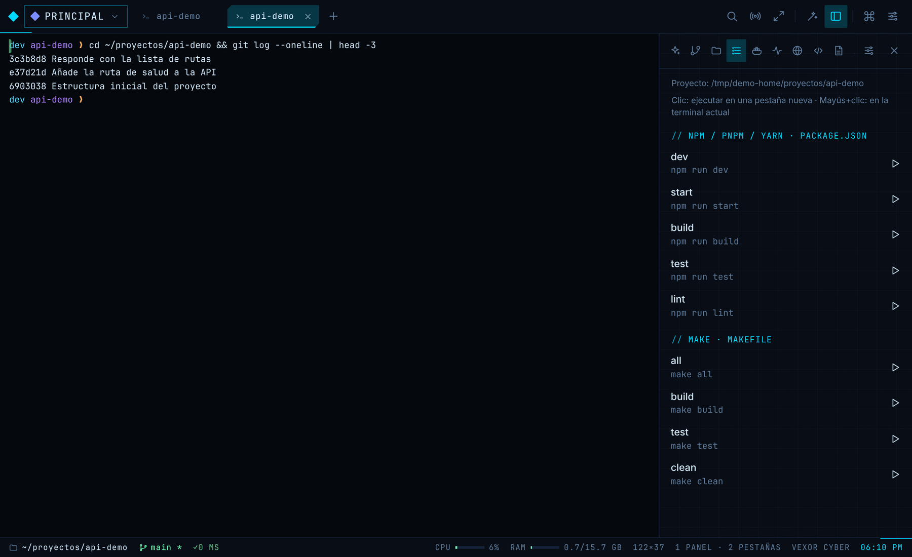
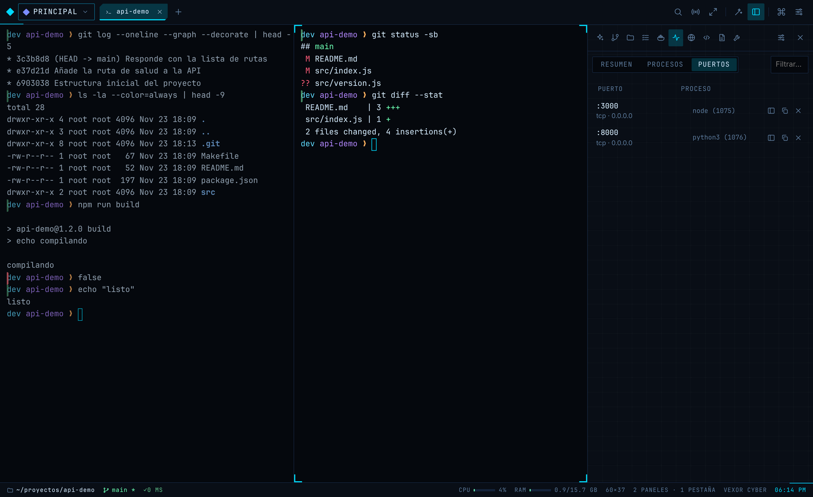

### Como Kitty / Alacritty
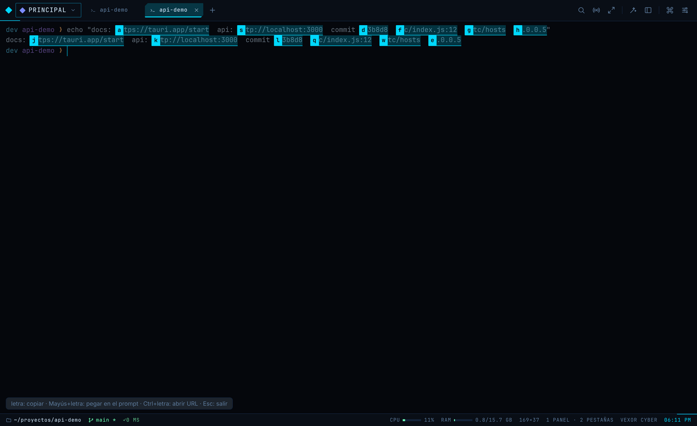
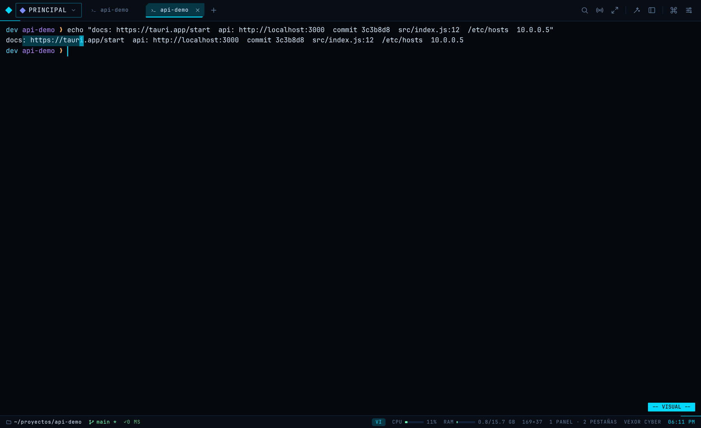
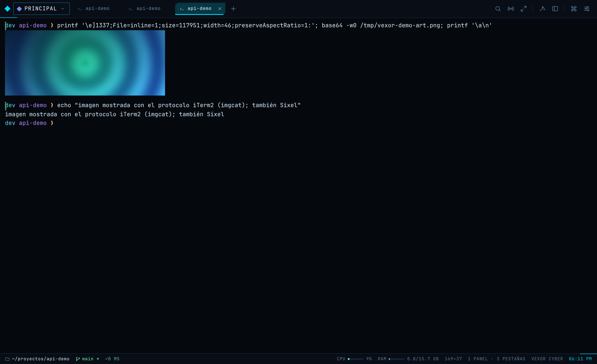
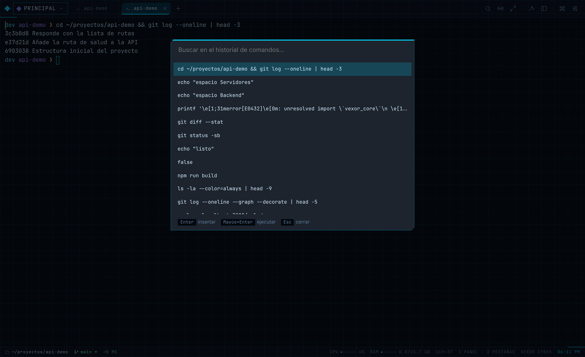

### Aspecto
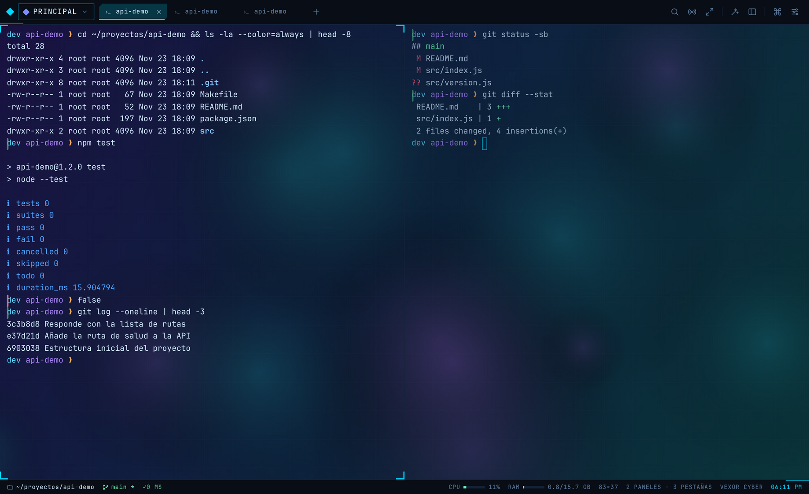
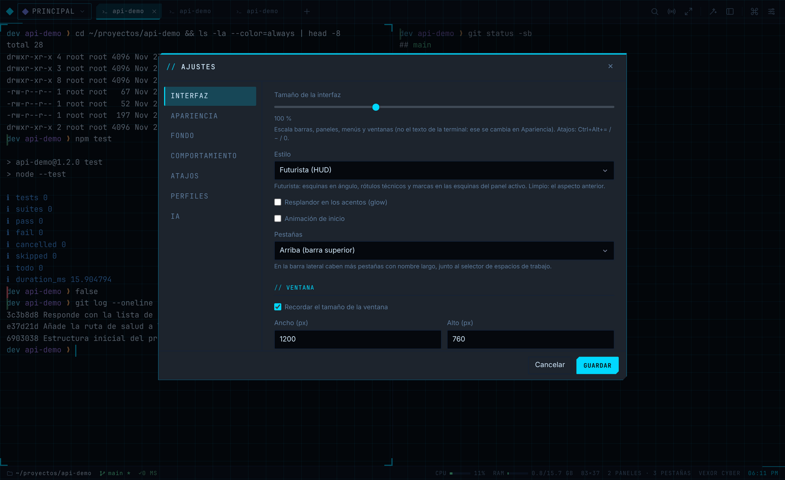

## Qué incluye

**Como Kitty / Alacritty**
- Pestañas y splits anidados, maximizar panel, broadcast, layouts guardables, perfiles, nueva ventana
- **Modo vi** (`Ctrl+Shift+Space`): `h j k l w b e 0 ^ $ gg G`, `v`/`V`, `y`/`Y`, `n`/`N`, contadores — copia con el teclado
- **Hints** (`Ctrl+Shift+H`): marca URLs, rutas, `archivo:línea`, IPs, hashes git y emails; letra = copiar, Mayús = pegar, Ctrl = abrir
- **Imágenes en la terminal**: Sixel y protocolo iTerm2 (`imgcat`, `chafa`, `img2sixel`…)
- Enlaces **OSC 8**, portapapeles **OSC 52** (solo escritura), Unicode 11, bracketed paste
- **Integración de shell** (bash/zsh/fish, se inyecta sola, sin tocar tus archivos): marca verde/roja junto a cada comando, saltar entre prompts, código de salida y duración, **aviso cuando termina un comando largo** si estás en otra pestaña/ventana
- Notificaciones desde programas (`OSC 9`, `OSC 777`), proceso en primer plano en la barra y confirmación al cerrar con un proceso en marcha
- **Atajos 100 % configurables** (editor en Ajustes) y argumentos de línea de comandos al estilo Alacritty: `--working-directory`, `-e`, `--title`, `--no-restore`
- Búsqueda con regex, pager del historial (`less`), exportar historial a HTML, menú contextual, arrastrar archivos para pegar su ruta, pegado seguro de varias líneas
- Opacidad de ventana (con el blur de Hyprland), tamaño/peso/espaciado de fuente, cursor, scrollback, shell, restauración de sesión

**Herramientas propias**
- **Comando con IA** (`Ctrl+Shift+K`) y **asistente** (`Ctrl+Shift+A`) con streaming y contexto de la terminal
- Paneles **Git** (rama, cambios, commits, pull/push) y **Docker** (logs, shell, iniciar/detener/reiniciar), **Archivos**, **Tareas** (package.json, Cargo, Makefile, justfile, compose), **Sistema** (resumen, procesos y puertos con terminar/matar), **Cliente HTTP**, **Snippets** (con variables `{{nombre}}`), **Notas**, **Herramientas** (claude, codex, gemini, aider, ollama, lazygit, nvim, btop, yazi…) y **SSH** desde `~/.ssh/config`
- Buscador de historial de comandos (`Ctrl+Shift+R`): bash, zsh y fish, incluidas las sesiones abiertas
- Barra de estado con directorio, rama git, proceso, último comando, CPU, RAM y reloj

## Comparación honesta con Kitty y Alacritty

Vexor corre dentro de un **webview** (WebKitGTK + xterm.js), no es un emulador nativo con GPU. **No es más rápido que Alacritty o Kitty** en rendimiento puro, y usa más memoria. Lo que ofrece es paridad en funciones de uso diario y herramientas integradas que ellos no traen.

| | Alacritty | Kitty | Vexor |
|---|---|---|---|
| Pestañas / splits | no (usa tmux) | sí | sí |
| Modo vi / hints | sí | hints | sí / sí |
| Imágenes | no | protocolo propio | Sixel + iTerm2 (**no** el protocolo de Kitty) |
| Integración de shell | no | sí | sí |
| Ligaduras de fuente | sí | sí | **no** (limitación de xterm.js) |
| Protocolo de teclado de Kitty | no | sí | **no** |
| Selección rectangular | sí | sí | **no** |
| Control remoto (`kitty @`, `alacritty msg`) | `msg` | sí | solo argumentos de línea de comandos |
| Fondo imagen / animado | no | imagen | sí / sí |
| IA, Git, Docker, snippets integrados | no | no | sí |

*(La comparación sale de la documentación de cada proyecto; compruébala con tu versión. No se han medido Kitty ni Alacritty.)*

**Mediciones propias** (modo navegador en un contenedor sin GPU, renderer DOM; no son comparables con otras terminales): arranque hasta el primer prompt ≈ 110 ms, 300 000 líneas ≈ 0,5 s, eco de una tecla ≈ 4 ms (mediana). Reprodúcelas con `npm run test:e2e`.

## Atajos

Todos se pueden cambiar en **Ajustes → Atajos**. `F1` muestra la lista completa. Principales:

| Acción | Atajo |
|---|---|
| Nueva pestaña / ventana | `Ctrl+Shift+T` / `Ctrl+Shift+N` |
| Dividir derecha / abajo · cerrar · maximizar | `Ctrl+Shift+D` / `E` · `W` · `Z` |
| Paleta de comandos · ajustes | `Ctrl+Shift+P` · `Ctrl+,` |
| Modo vi · hints · saltar prompts | `Ctrl+Shift+Space` · `H` · `↑` / `↓` |
| Comando con IA · asistente · Git · Docker | `Ctrl+Shift+K` · `A` · `G` · `O` |
| Archivos · tareas · procesos · notas · historial | `Ctrl+Shift+J` · `M` · `Y` · `Q` · `R` |
| Cliente HTTP · copiar salida del último comando | `Ctrl+Alt+A` · `Ctrl+Shift+X` |
| Espacios de trabajo (ir / nuevo / siguiente) | `Ctrl+Alt+1…9` · `Ctrl+Alt+N` · `Ctrl+Alt+RePág/AvPág` |
| Interfaz más grande / pequeña / 100 % · zen | `Ctrl+Alt+=` / `−` / `0` · `Ctrl+Shift+Enter` |
| Buscar · broadcast · copiar / pegar | `Ctrl+Shift+F` · `B` · `C` / `V` |

## Configuración

`~/.config/vexor/config.json` (permisos `0600`; la API key de la IA nunca vuelve al frontend). Todo se cambia desde **Ajustes** (`Ctrl+,`): interfaz, apariencia, fondo, comportamiento, atajos, perfiles e IA.

## Compilar para desarrollo

```bash
sudo pacman -S --needed webkit2gtk-4.1 gtk3 libsoup3 base-devel rust nodejs npm
npm install
npm run tauri dev                      # desarrollo
npm run tauri build -- --no-bundle     # binario en src-tauri/target/release/vexor
```

## Pruebas

```bash
npm run test:rust      # pruebas de Rust (PTY, OSC 133, UTF-8, /proc, git, ssh, historial, procesos, puertos, tareas…)
npm run test:e2e       # comprobaciones de la interfaz con Playwright (necesita Playwright + Chromium)
```

El e2e usa un servidor de IA **simulado** y un `docker` **falso** (en `tests/e2e/`), así que no prueba la API real de Anthropic ni Docker real.

### Modo navegador (solo para probar la interfaz)

`npm run web` → http://127.0.0.1:4173 (servidor Node con `node-pty`; añade `?renderer=dom` si tu GPU da problemas con WebGL).

## Estructura

```
src/              interfaz (JavaScript + CSS, xterm.js)
src-tauri/        aplicación nativa (Rust: PTY, IA, Git, Docker, sistema) y scripts de integración de shell
dev/server.js     servidor del modo navegador
packaging/arch/   PKGBUILD y .desktop
scripts/          instalador para Omarchy
tests/e2e/        pruebas de la interfaz
docs/             capturas
```

Historial de versiones en [CHANGELOG.md](CHANGELOG.md).
